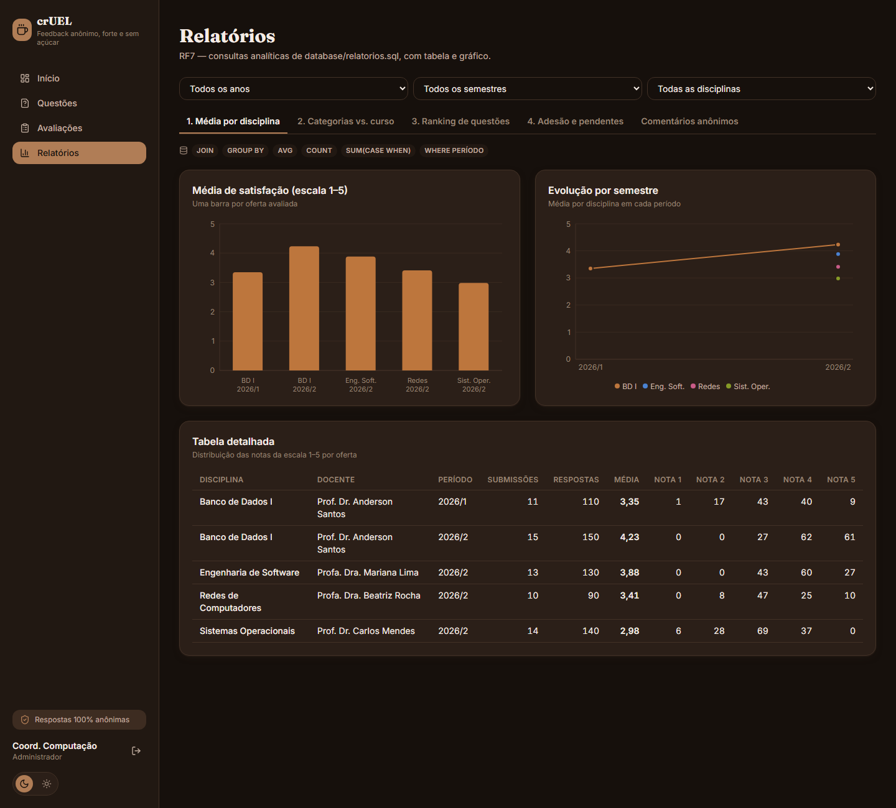
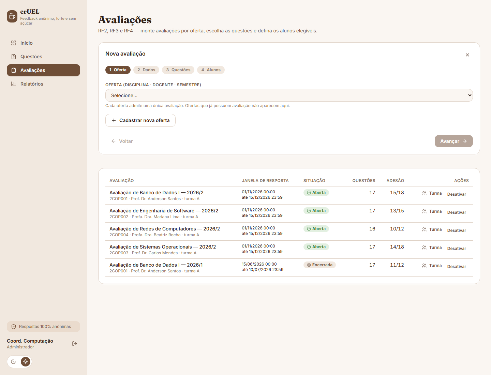
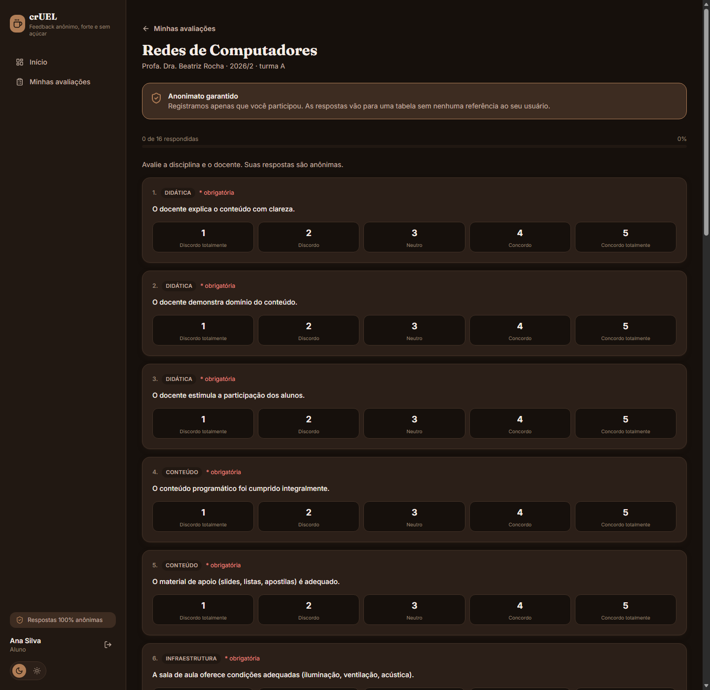
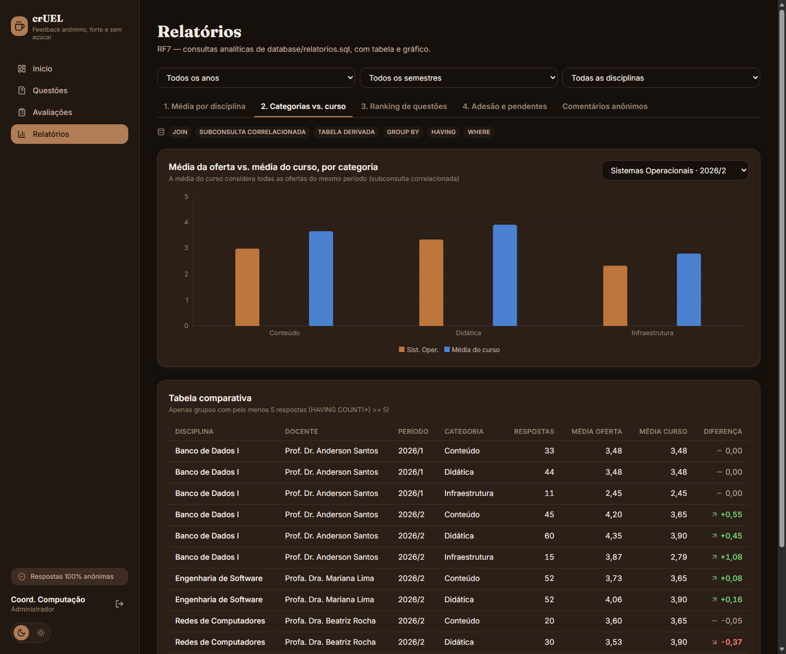
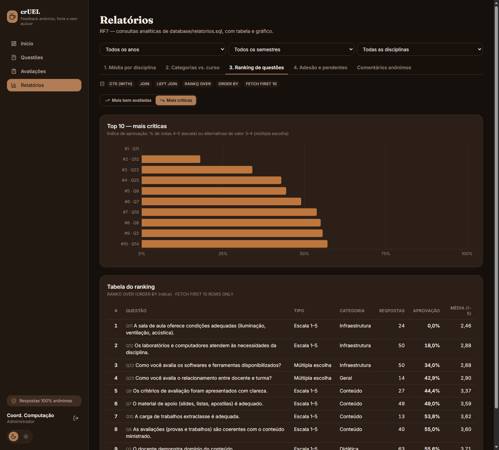
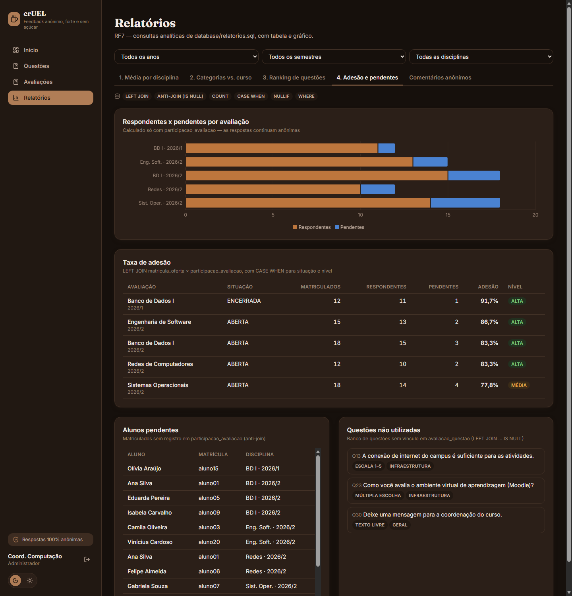
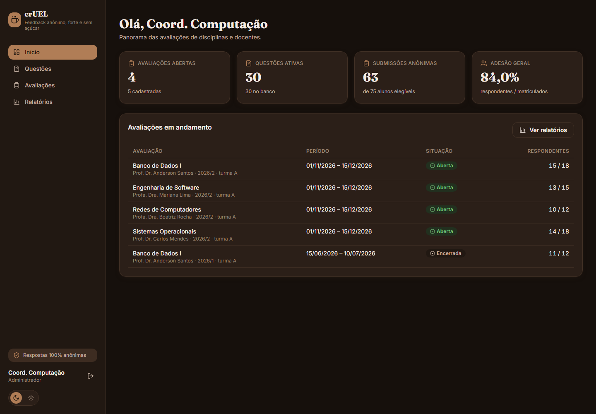
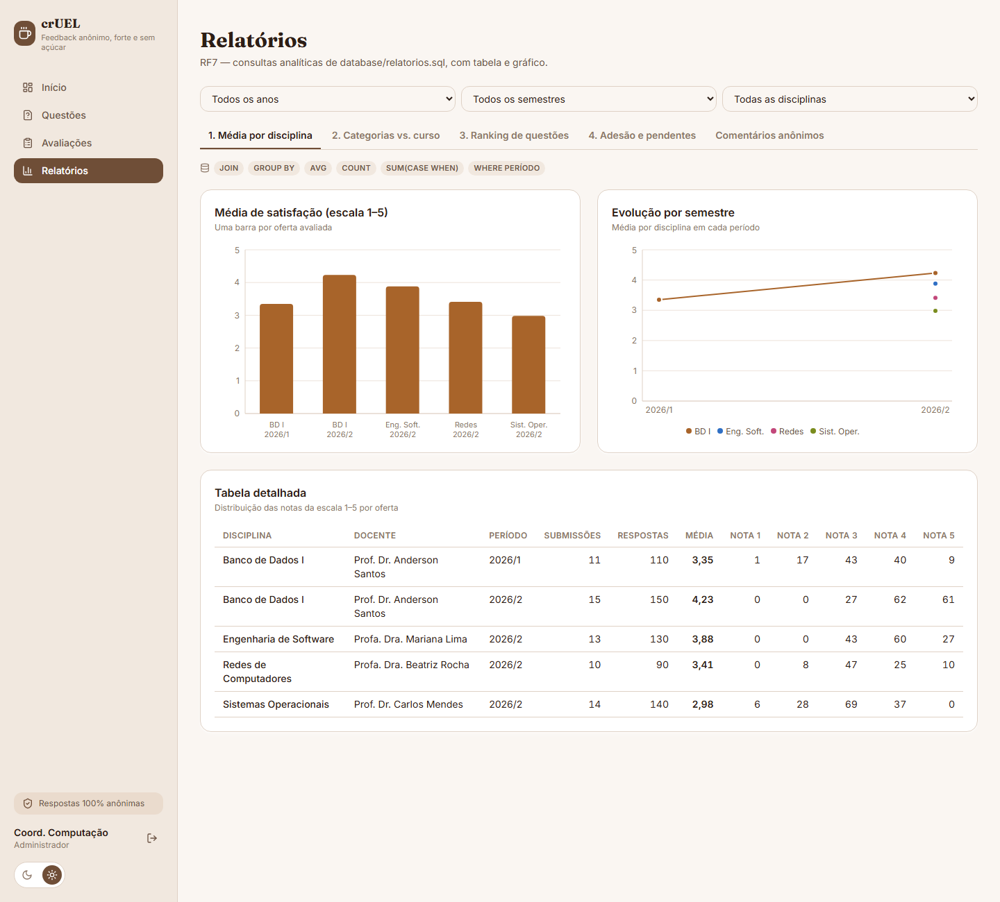

# crUEL — Critérios e Resultados da Universidade Estadual de Londrina

Sistema web de **Avaliação Anônima de Disciplinas e Docentes** desenvolvido como projeto final da disciplina de **Banco de Dados I**.



## Identificação

* **Aluno(s):** `Kauã Felipe Martins`
* **Professor:** Prof. Dr. Anderson Paulo Avila Santos
* **Disciplina:** Banco de Dados I
* **Instituição:** Universidade Estadual de Londrina (UEL)

## Sobre o Projeto

O `Consulta e Relatório Unificado de Ensino e Lecionamento`, ou se preferir, `crUEL` (*"Feedback anônimo, forte e sem açúcar"*) tem como objetivo aplicar na prática os conceitos de modelagem de dados (DER/MER), normalização até a **3ª Forma Normal (3FN)**, DDL/DML em **PostgreSQL** e consultas SQL analíticas integradas a uma arquitetura em camadas.

### Natureza do Sistema e Particularidade (RF6)

* **Natureza:** Avaliação de Disciplinas ou de Docentes.
* **Regra de Negócio (Anonimato e Unicidade):** Cada aluno pode avaliar cada disciplina/oferta uma única vez por ano/semestre, mas suas respostas são **100% anônimas**. No banco de dados, o registro de quem já participou (`participacao_avaliacao`) é fisicamente separado da submissão das respostas (`submissao_anonima` e `resposta_questao`), sem qualquer vínculo de chave estrangeira com o usuário.

Como isso é garantido:

| Camada | Mecanismo |
|---|---|
| **Esquema** | `participacao_avaliacao` tem `PRIMARY KEY (id_avaliacao, id_usuario)` → uma 2ª resposta do mesmo aluno viola a PK. `submissao_anonima` e `resposta_questao` **não possuem coluna nem FK** que leve ao usuário. |
| **Sem correlação por ordem** | A submissão usa chave **UUID aleatória** (`gen_random_uuid()`) e as duas tabelas guardam apenas a **data** (sem hora): não dá para casar "o 5º a participar" com "a 5ª submissão". |
| **Transação** | `RespostaService.registrarSubmissaoAnonima` (`@Transactional`) grava participação + submissão + respostas atomicamente; uma 2ª tentativa retorna **HTTP 409** e nada é gravado. |
| **Elegibilidade** | Só alunos matriculados na oferta (`matricula_oferta`) e dentro da janela de data/hora da avaliação podem responder. |
| **API / Logs** | A resposta HTTP não devolve o id da submissão e os logs não registram usuário nem submissão. |

## Stack Tecnológica

* **Banco de Dados:** PostgreSQL 16
* **Back-end:** Java 21 + Spring Boot 4 (acesso ao banco exclusivamente via **JDBC e classes DAO** — `JdbcTemplate`, `PreparedStatement`, `KeyHolder`, `RowMapper` — sem JPA/Hibernate)
* **Front-end:** React 18 (Vite + Tailwind CSS + Recharts + Lucide) com tema marrom escuro (*Espresso*) e alternância *Dark/Light* (*Latte*)

## Estrutura do Repositório

```
.
├── database/
│   ├── schema.sql        # DDL (11 tabelas, PK/FK/UNIQUE/CHECK/NOT NULL) — 3FN
│   ├── carga.sql         # DML: 27 usuários, 4 disciplinas, 5 avaliações, 30 questões, 63 submissões
│   └── relatorios.sql    # 4 relatórios analíticos comentados
├── docs/
│   ├── DER.md / DER.png / DER.mmd           # Diagrama Entidade-Relacionamento
│   ├── MER_e_esquema_relacional.md          # MER, mapeamento relacional e justificativa da 3FN
│   └── prints/                              # capturas de tela do sistema
├── backend/              # API REST Spring Boot (controller → service → dao → PostgreSQL)
├── frontend/             # SPA React (Vite)
├── docker-compose.yml    # PostgreSQL 16 (opcional)
└── .env.example          # variáveis de ambiente
```

Arquitetura em camadas do back-end (`backend/src/main/java/br/uel/avaliacao`):

| Pacote | Responsabilidade |
|---|---|
| `controller/` | Endpoints REST (`/api/auth`, `/api/questoes`, `/api/avaliacoes`, `/api/ofertas`, `/api/respostas`, `/api/relatorios`…) |
| `service/` | Regras de negócio e transações (`AvaliacaoService`, `RespostaService`, `RelatorioService`, `CatalogoService`) |
| `dao/` | SQL parametrizado com JDBC (`UsuarioDAO`, `DisciplinaDAO`, `QuestaoDAO`, `AvaliacaoDAO`, `RespostaDAO`, `RelatorioDAO`) |
| `model/`, `dto/` | Records de domínio e de entrada/saída |
| `config/`, `exception/` | DataSource/transações, CORS, autenticação simplificada e tratamento global de erros |

## Como Executar Localmente

### Pré-requisitos

* PostgreSQL 16+ **ou** Docker
* Java 21+ (o Maven Wrapper `mvnw` já vem no projeto — não é preciso instalar o Maven)
* Node.js 20+

### 1. Variáveis de ambiente

```bash
cp .env.example .env                    # credenciais do banco usadas pelo back-end
cp frontend/.env.example frontend/.env  # URL da API usada pelo front-end
```

| Variável | Padrão | Uso |
|---|---|---|
| `DB_HOST` / `DB_PORT` / `DB_NAME` | `localhost` / `5432` / `avaliacao_docente_db` | conexão JDBC |
| `DB_USER` / `DB_PASSWORD` | `postgres` / `postgres` | credenciais |
| `SERVER_PORT` | `8080` | porta da API |
| `CORS_ALLOWED_ORIGINS` | `http://localhost:5173` | origem do front-end |
| `VITE_API_URL` (frontend/.env) | `http://localhost:8080/api` | endereço da API |

### 2. Banco de dados

**Opção A — Docker** (cria o banco e já executa `schema.sql` + `carga.sql` na primeira subida):

```bash
docker compose up -d
```

**Opção B — PostgreSQL local:**

```bash
psql -U postgres -c "CREATE DATABASE avaliacao_docente_db;"
psql -U postgres -d avaliacao_docente_db -v ON_ERROR_STOP=1 -f database/schema.sql
psql -U postgres -d avaliacao_docente_db -v ON_ERROR_STOP=1 -f database/carga.sql
psql -U postgres -d avaliacao_docente_db -v ON_ERROR_STOP=1 -f database/relatorios.sql   # (opcional) ver os relatórios
```

> Os scripts são idempotentes: para "zerar" o banco, basta executar `schema.sql` e `carga.sql` novamente.
> Com Docker: `docker compose down -v && docker compose up -d`.

### 3. Back-end (porta 8080)

```bash
cd backend
./mvnw spring-boot:run          # Windows: mvnw.cmd spring-boot:run
# testes: ./mvnw test           # build: ./mvnw clean package
```

### 4. Front-end (porta 5173)

```bash
cd frontend
npm install
npm run dev
```

Acesse **http://localhost:5173**.

### Usuários de demonstração (senha `123456` para todos)

| Perfil | Login | O que pode fazer |
|---|---|---|
| Administrador | `coordenacao.dc@uel.br` ou `admin01` | Questões, avaliações, turmas e relatórios |
| Docente | `anderson.santos@uel.br` ou `doc01` | Consultar questões, avaliações e relatórios |
| Aluno | `ana.silva@uel.br` ou `aluno01` | Responder avaliações (Ana tem BD I e Redes pendentes) |

Os demais alunos vão de `aluno02` a `aluno21` (ex.: `bruno.costa@uel.br`). A tela de login tem botões de acesso rápido.

## Funcionalidades (Requisitos Funcionais)

| RF | Descrição | Onde |
|---|---|---|
| RF1 | Cadastro de questões (múltipla escolha com alternativas, escala 1–5, texto livre) | Questões · `POST /api/questoes` |
| RF2 | Criação de avaliação vinculada a uma oferta (disciplina, docente, ano/semestre) com janela de data/hora | Avaliações → Nova avaliação |
| RF3 | Seleção e ordenação das questões da avaliação (obrigatórias/opcionais) | Assistente, passo 3 |
| RF4 | Vínculo de turmas/alunos elegíveis à oferta | Assistente, passo 4 · botão **Turma** |
| RF5 | Aluno responde as avaliações abertas das ofertas em que está matriculado | Minhas avaliações |
| RF6 | Resposta única por aluno/avaliação, anônima | ver seção "Particularidade" |
| RF7 | Relatórios com tabela + gráfico e filtros (ano, semestre, disciplina) | Relatórios |

| Admin — Assistente de avaliação | Aluno — Responder com anonimato |
|---|---|
|  |  |

## Relatórios (RF7) — `database/relatorios.sql`

Os relatórios são exibidos em **Relatórios** com gráfico + tabela e aceitam filtros por ano, semestre e disciplina
(no `RelatorioDAO` os valores fixos do script viram parâmetros: `(CAST(:ano AS INTEGER) IS NULL OR o.ano = :ano)`).

| Recurso SQL exigido | Relatórios |
|---|---|
| `JOIN` | 1, 2, 3, 4 |
| `LEFT JOIN` | 3, 4 (4a, 4b, 4c) |
| `GROUP BY` + agregação (`AVG`, `COUNT`, `SUM`) | 1, 2, 3, 4 |
| Subconsulta | 2 (correlacionada + tabela derivada) |
| `ORDER BY` + `RANK() OVER` + `FETCH FIRST` | 3 |
| `WHERE` com filtros | 1, 2, 3, 4 |

Extras: `HAVING` (2), `CASE WHEN` (1, 3, 4), CTE `WITH` (3), `NULLIF` (4).

### Relatório 1 — Média geral e distribuição por disciplina/docente

* **Objetivo:** média de satisfação (questões de escala 1–5), total de submissões anônimas e distribuição das notas por oferta; com o filtro de período removido, mostra a **evolução entre semestres** (BD I: 3,35 em 2026/1 → 4,23 em 2026/2).
* **Recursos:** `JOIN` (5 tabelas), `GROUP BY`, `AVG`, `COUNT`, `SUM(CASE WHEN …)`, `WHERE` por ano/semestre.
* **Gráficos:** barras (média por oferta) e linha (evolução por semestre).

```sql
SELECT d.codigo, d.nome AS disciplina, doc.nome AS docente, o.ano, o.semestre,
       COUNT(DISTINCT s.id_submissao) AS total_submissoes,
       ROUND(AVG(r.nota_escala), 2)   AS media_escala,
       SUM(CASE WHEN r.nota_escala = 5 THEN 1 ELSE 0 END) AS qtd_nota_5  -- … notas 1 a 5
FROM avaliacao a
JOIN oferta_disciplina o ON o.id_oferta     = a.id_oferta
JOIN disciplina d        ON d.id_disciplina = o.id_disciplina
JOIN usuario doc         ON doc.id_usuario  = o.id_docente
JOIN submissao_anonima s ON s.id_avaliacao  = a.id_avaliacao
JOIN resposta_questao r  ON r.id_submissao  = s.id_submissao
WHERE r.nota_escala IS NOT NULL AND o.ano = 2026 AND o.semestre = 2
GROUP BY d.codigo, d.nome, doc.nome, o.ano, o.semestre
ORDER BY media_escala DESC;
```

### Relatório 2 — Desempenho por categoria vs. média geral do curso

* **Objetivo:** comparar a média de cada oferta em Didática, Conteúdo e Infraestrutura com a média de **todas** as ofertas do mesmo período naquela categoria.
* **Recursos:** **subconsulta correlacionada** (média do curso), subconsulta no `FROM` (tabela derivada para calcular a diferença), `JOIN`, `GROUP BY`, `HAVING COUNT(*) >= 5`, `WHERE`.
* **Gráfico:** barras comparativas (oferta × média do curso) por categoria.

```sql
SELECT t.*, ROUND(t.media_oferta - t.media_curso, 2) AS diferenca
FROM (
    SELECT d.nome AS disciplina, doc.nome AS docente, o.ano, o.semestre, q.categoria,
           ROUND(AVG(r.nota_escala), 2) AS media_oferta,
           (SELECT ROUND(AVG(r2.nota_escala), 2)
              FROM resposta_questao r2
              JOIN questao q2           ON q2.id_questao   = r2.id_questao
              JOIN submissao_anonima s2 ON s2.id_submissao = r2.id_submissao
              JOIN avaliacao a2         ON a2.id_avaliacao = s2.id_avaliacao
              JOIN oferta_disciplina o2 ON o2.id_oferta    = a2.id_oferta
             WHERE q2.categoria = q.categoria AND o2.ano = o.ano AND o2.semestre = o.semestre
               AND r2.nota_escala IS NOT NULL) AS media_curso
    FROM avaliacao a
    JOIN oferta_disciplina o ON … JOIN questao q ON q.id_questao = r.id_questao
    WHERE r.nota_escala IS NOT NULL AND q.categoria IN ('DIDATICA','CONTEUDO','INFRAESTRUTURA')
    GROUP BY d.nome, doc.nome, o.ano, o.semestre, q.categoria
    HAVING COUNT(*) >= 5
) AS t;
```



### Relatório 3 — Ranking das Top 10 questões (melhores e mais críticas)

* **Objetivo:** ranquear as questões objetivas pelo **índice de aprovação** (% de notas 4–5 na escala ou alternativas de valor 3–4) — expõe, por exemplo, que a **infraestrutura** concentra as piores avaliações.
* **Recursos:** CTE (`WITH`), `JOIN`, `LEFT JOIN alternativa`, `GROUP BY`, `CASE WHEN`, `RANK() OVER (ORDER BY …)`, `ORDER BY`, `FETCH FIRST 10 ROWS ONLY`, `WHERE`.
* **Gráfico:** barras horizontais (ranking), com alternância "mais bem avaliadas" / "mais críticas".

```sql
WITH indice AS (
    SELECT q.id_questao, q.enunciado, q.tipo, q.categoria, COUNT(*) AS total_respostas,
           ROUND(100.0 * SUM(CASE WHEN r.nota_escala >= 4 OR alt.valor_numerico >= 3
                                  THEN 1 ELSE 0 END) / COUNT(*), 1) AS indice_aprovacao
    FROM questao q
    JOIN resposta_questao r   ON r.id_questao = q.id_questao
    JOIN submissao_anonima s  ON … JOIN avaliacao a ON … JOIN oferta_disciplina o ON …
    LEFT JOIN alternativa alt ON alt.id_alternativa = r.id_alternativa
    WHERE q.tipo IN ('ESCALA_1_5', 'MULTIPLA_ESCOLHA') AND o.ano = 2026 AND o.semestre = 2
    GROUP BY q.id_questao, q.enunciado, q.tipo, q.categoria
)
SELECT RANK() OVER (ORDER BY indice_aprovacao DESC) AS posicao, indice.*
FROM indice ORDER BY posicao FETCH FIRST 10 ROWS ONLY;
```



### Relatório 4 — Taxa de adesão e alunos pendentes

* **Objetivo:** para cada avaliação, quantos matriculados já responderam, a taxa de adesão e **quem ainda está pendente** — usando apenas `participacao_avaliacao`, ou seja, sem tocar nas respostas (o anonimato é preservado). Inclui também as questões do banco que não são usadas em nenhuma avaliação.
* **Recursos:** `LEFT JOIN` (matrículas × participações), anti-join `LEFT JOIN … WHERE p.id_usuario IS NULL`, `COUNT`, `CASE WHEN` (situação e nível de adesão), `NULLIF`, `WHERE`.
* **Gráfico:** barras empilhadas (respondentes × pendentes) + tabelas.

```sql
SELECT a.id_avaliacao, d.nome AS disciplina, o.ano, o.semestre,
       COUNT(m.id_usuario) AS matriculados,
       COUNT(p.id_usuario) AS respondentes,
       ROUND(100.0 * COUNT(p.id_usuario) / NULLIF(COUNT(m.id_usuario), 0), 1) AS taxa_adesao,
       CASE WHEN COUNT(p.id_usuario) >= 0.8 * COUNT(m.id_usuario) THEN 'ALTA'
            WHEN COUNT(p.id_usuario) >= 0.5 * COUNT(m.id_usuario) THEN 'MÉDIA'
            ELSE 'BAIXA' END AS nivel_adesao
FROM avaliacao a
JOIN oferta_disciplina o           ON o.id_oferta    = a.id_oferta
JOIN disciplina d                  ON d.id_disciplina = o.id_disciplina
LEFT JOIN matricula_oferta m       ON m.id_oferta    = a.id_oferta
LEFT JOIN participacao_avaliacao p ON p.id_avaliacao = a.id_avaliacao AND p.id_usuario = m.id_usuario
WHERE a.ativa = TRUE
GROUP BY a.id_avaliacao, d.nome, o.ano, o.semestre
ORDER BY taxa_adesao DESC;
```



## Modelagem

* **DER:** [`docs/DER.md`](docs/DER.md) (Mermaid, renderizado pelo GitHub) e [`docs/DER.png`](docs/DER.png)
* **MER, esquema relacional e justificativa da 3FN:** [`docs/MER_e_esquema_relacional.md`](docs/MER_e_esquema_relacional.md)

## Tema visual

Paleta marrom com tema escuro **Espresso** (padrão) e claro **Latte**, alternados pelo botão lua/sol (a escolha fica salva no navegador).
As cores dos gráficos (cobre, azul, oliva, framboesa) foram validadas para daltonismo e contraste nos dois temas.

| Espresso (escuro) | Latte (claro) |
|---|---|
|  |  |

## Testes e validação

```bash
cd backend && ./mvnw test      # 15 testes: regras do RF6 (409 na 2ª resposta, janela, matrícula,
                               # validação por tipo) e verificações estruturais (sem JPA, sem id_usuario nas tabelas anônimas)
cd frontend && npm run build
```
