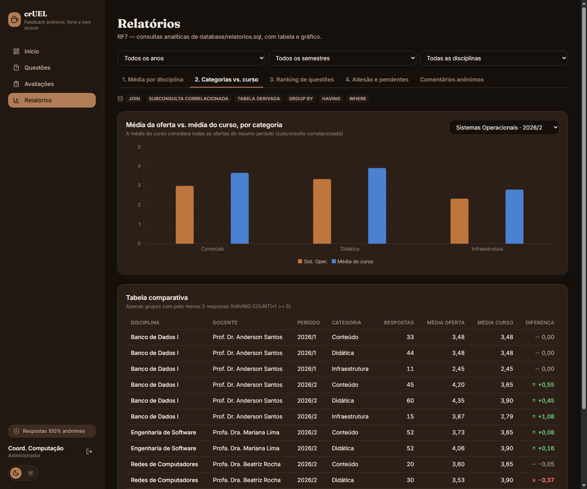
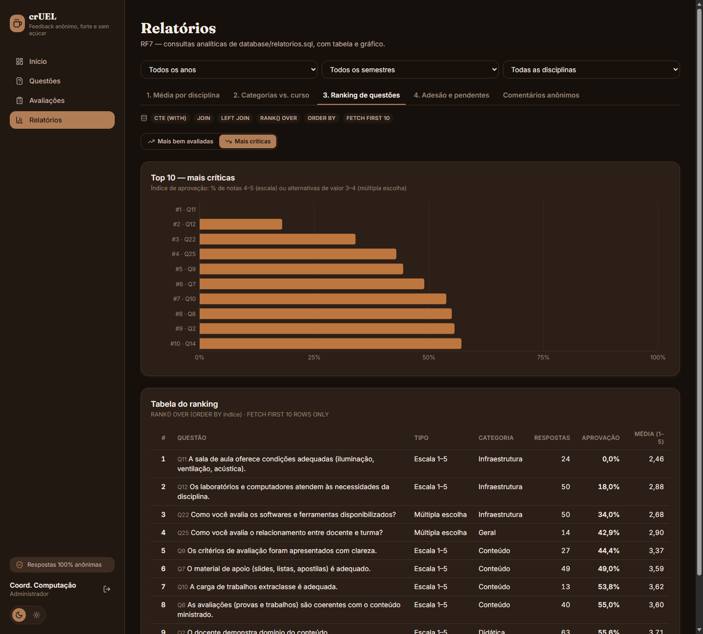
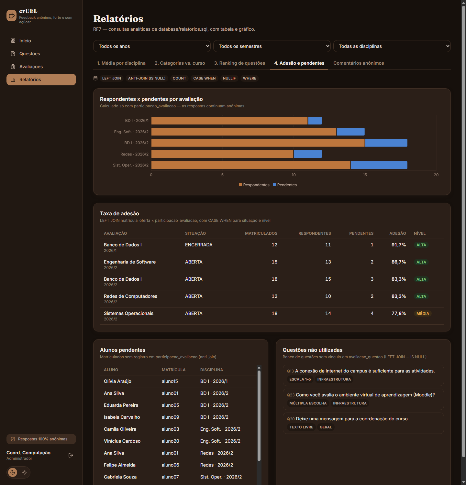

# crUEL — Sistema de Avaliação de Disciplinas e Docentes

Projeto final da disciplina de **Banco de Dados I** da Universidade Estadual de Londrina (UEL), desenvolvido por **Kauã Felipe Martins**, sob orientação do **Prof. Dr. Anderson Paulo Avila Santos**.

O **crUEL** (*Consulta e Relatório Unificado de Ensino e Lecionamento* — "feedback anônimo, forte e sem açúcar") é um sistema web em que:

- o **administrador** cadastra questões, monta avaliações por oferta de disciplina e define os alunos elegíveis;
- o **aluno** responde, uma única vez e de forma anônima, às avaliações das disciplinas em que está matriculado;
- o **docente** acompanha os resultados **somente das disciplinas que ministra**, sem conseguir identificar quem respondeu.


> Detalhes de execução, consultas SQL completas e solução de problemas estão em [PROJETO.md](PROJETO.md).

## Natureza escolhida e particularidade (RF6)

**Avaliação de disciplinas ou docentes.**

Cada aluno pode responder cada avaliação apenas uma vez, e as respostas não podem ser associadas à sua identidade. Isso é garantido pela separação física, no banco, entre *quem* respondeu e *o que* foi respondido:

| Tabela | Conteúdo | Garantia |
|---|---|---|
| `participacao_avaliacao` | aluno + avaliação + data | PK composta `(id_avaliacao, id_usuario)` bloqueia a segunda resposta |
| `submissao_anonima` | avaliação + data (chave UUID aleatória) | **sem** coluna ou FK para `usuario` |
| `resposta_questao` | respostas de cada questão | **sem** coluna ou FK para `usuario` |

Além disso:

- participação, submissão e respostas são gravadas em **uma única transação JDBC** — uma segunda tentativa retorna HTTP 409 e nada é gravado;
- as tabelas guardam só a **data** (sem hora) e a submissão usa UUID aleatório, impedindo correlacionar "o 5º a participar" com "a 5ª submissão";
- a API não devolve o id da submissão e os logs não registram usuário nem submissão;
- os comentários de texto livre são listados sem identificador e em ordem alfabética.

## Perfis e visibilidade

A autenticação é simplificada: o front-end envia o cabeçalho `X-User-Id` obtido no login e o back-end **consulta o perfil no banco** a cada requisição (o perfil nunca é lido do cliente). Todas as restrições abaixo são aplicadas no back-end, não apenas escondidas na interface.

| Recurso | ADMIN | DOCENTE | ALUNO |
|---|---|---|---|
| Cadastrar questões, ofertas, avaliações e turmas | ✅ | — | — |
| Banco de questões | todas | só as usadas nas suas avaliações | — |
| Lista de avaliações e dashboard | todas | só das ofertas que ministra | as suas (matriculado) |
| Relatórios 1 a 3 (médias, categorias, ranking) | todas as ofertas | só as suas ofertas | — |
| Adesão (totais de respondentes/pendentes) | todas | só as suas avaliações | — |
| **Lista nominal de alunos pendentes** | ✅ | ❌ (apenas o total) | — |
| Questões não utilizadas | ✅ | ❌ | — |
| Comentários anônimos | todas as avaliações | só das suas avaliações | — |
| Responder avaliação | — | — | ✅ (uma vez) |

O docente não vê *quais* alunos ainda não responderam: em turmas pequenas, saber quem falta permitiria deduzir quem respondeu o quê, quebrando o anonimato. Ele vê apenas quantos faltam no total.

No relatório 2, o docente continua vendo a **média do curso** por categoria como referência de comparação — um valor agregado que não identifica nenhum outro docente ou disciplina.

## Requisitos implementados

| Requisito | Implementação | Onde |
|---|---|---|
| RF1 | Cadastro de questões de múltipla escolha (com alternativas), escala de 1 a 5 e texto livre | Questões |
| RF2 | Avaliação vinculada a uma oferta (disciplina, docente, ano/semestre, turma) com janela de data/hora | Avaliações → Nova avaliação |
| RF3 | Seleção e ordenação das questões da avaliação, obrigatórias ou opcionais | Assistente, passo 3 |
| RF4 | Vínculo dos alunos elegíveis à oferta | Assistente, passo 4 · botão **Turma** |
| RF5 | Aluno responde às avaliações abertas das ofertas em que está matriculado | Minhas avaliações |
| RF6 | Resposta única por aluno/avaliação, anônima | ver seção acima |
| RF7 | Quatro relatórios com tabela, gráfico e filtros por ano, semestre e disciplina | Relatórios |

## Tecnologias

- **Banco:** PostgreSQL 16
- **Back-end:** Java 21 + Spring Boot, acesso ao banco **exclusivamente por JDBC e classes DAO** (`JdbcTemplate`, `NamedParameterJdbcTemplate`, `PreparedStatement`, `KeyHolder`, `RowMapper`)
- **Front-end:** React 18 + Vite + Tailwind CSS, gráficos com Recharts e ícones Lucide; tema escuro *Espresso* e claro *Latte*

O back-end **não** utiliza JPA, Hibernate, Spring Data JPA ou qualquer ORM — um teste automatizado (`ArquiteturaTest`) verifica isso.

## Estrutura do repositório

```text
.
├── backend/                         # API REST Spring Boot
│   └── src/main/java/br/uel/avaliacao/
│       ├── config/                  # DataSource, CORS, AuthInterceptor (perfil lido do banco)
│       ├── controller/              # endpoints /api/auth, /questoes, /avaliacoes, /ofertas, /respostas, /relatorios
│       ├── service/                 # regras de negócio, transações e escopo por perfil
│       ├── dao/                     # SQL parametrizado com JDBC
│       ├── model/  dto/             # records de domínio e de entrada/saída
│       └── exception/               # tratamento global de erros
├── frontend/src/
│   ├── pages/                       # Dashboard, Questões, Avaliações, Relatórios, Minhas avaliações, Responder
│   ├── components/  context/        # layout, UI, autenticação e tema
│   └── services/api.js              # cliente HTTP
├── database/
│   ├── schema.sql                   # DDL (11 tabelas, PK/FK/UNIQUE/CHECK/NOT NULL) — 3FN
│   ├── carga.sql                    # massa de dados de demonstração
│   └── relatorios.sql               # as 4 consultas analíticas comentadas
└── docs/                            # DER, MER, esquema relacional e prints
```

Fluxo das camadas: **tela React → controller → service → DAO → PostgreSQL**. As telas nunca executam SQL.

## Modelagem e integridade

O DER está em [docs/DER.md](docs/DER.md) e [docs/DER.png](docs/DER.png); o esquema relacional e a justificativa da 3FN, em [docs/MER_e_esquema_relacional.md](docs/MER_e_esquema_relacional.md).

O [database/schema.sql](database/schema.sql) recria o banco do zero com chave primária em todas as entidades, chaves estrangeiras, `NOT NULL`, `UNIQUE` e `CHECK` (inclusive a coerência entre tipo de questão e tipo de resposta) e a chave composta que bloqueia a repetição da participação. Disciplinas, ofertas, usuários, questões, alternativas e respostas ficam em entidades próprias, sem dependências transitivas nem grupos repetitivos.

## Dados de demonstração (`carga.sql`)

- 27 usuários: 2 ADMIN, 4 DOCENTE e 21 ALUNO — **senha `123456` para todos**;
- 4 disciplinas e 5 ofertas (4 em 2026/2 e uma histórica de Banco de Dados I em 2026/1);
- 5 avaliações e 30 questões (15 de escala, 10 de múltipla escolha, 5 de texto livre);
- 63 submissões anônimas geradas com ruído pseudoaleatório determinístico (`setseed`);
- casos propositais para os relatórios: alunos matriculados que não responderam e questões não usadas em nenhuma avaliação.

Médias obtidas nas questões de escala:

| Oferta | Docente | Média |
|---|---|---|
| Banco de Dados I — 2026/2 | Prof. Dr. Anderson Santos | 4,57 |
| Banco de Dados I — 2026/1 | Prof. Dr. Anderson Santos | 4,05 |
| Engenharia de Software — 2026/2 | Profa. Dra. Mariana Lima | 3,88 |
| Redes de Computadores — 2026/2 | Profa. Dra. Beatriz Rocha | 3,41 |
| Sistemas Operacionais — 2026/2 | Prof. Dr. Carlos Mendes | 2,98 |

| Perfil | Login | O que ver |
|---|---|---|
| Administrador | `admin01` ou `coordenacao.dc@uel.br` | tudo: cadastros, turmas, relatórios completos e pendentes por nome |
| Docente | `doc01` ou `anderson.santos@uel.br` | apenas as avaliações e resultados de Banco de Dados I |
| Aluno | `aluno01` ou `ana.silva@uel.br` | Ana tem BD I e Redes pendentes para responder |

Os demais alunos vão de `aluno02` a `aluno21`, e os docentes de `doc01` a `doc04`. A tela de login tem botões de acesso rápido.

## Como executar

### Pré-requisitos

- PostgreSQL 16 ou superior
- Java 21 (o Maven Wrapper `backend/mvnw` já vem no projeto)
- Node.js 20 ou superior e npm

> **Windows:** se os acentos aparecerem desformatados (ex.: `Avaliação`), execute antes, no mesmo terminal,
> `chcp 65001` e `$env:PGCLIENTENCODING = "UTF8"` (PowerShell). Os comandos completos para PowerShell, cmd e
> Git Bash estão em [PROJETO.md](PROJETO.md#windows-acentos-aparecendo-desformatados).

### 1. Configuração

```bash
cp .env.example .env                    # credenciais do banco (back-end)
cp frontend/.env.example frontend/.env  # URL da API (front-end)
```

| Variável | Padrão |
|---|---|
| `DB_HOST` / `DB_PORT` / `DB_NAME` | `localhost` / `5432` / `avaliacao_docente_db` |
| `DB_USER` / `DB_PASSWORD` | `postgres` / `postgres` |
| `SERVER_PORT` | `8080` |
| `CORS_ALLOWED_ORIGINS` | `http://localhost:5173` |
| `VITE_API_URL` (frontend/.env) | `http://localhost:8080/api` |

### 2. Banco de dados

```bash
psql -U postgres -c "CREATE DATABASE avaliacao_docente_db ENCODING 'UTF8' TEMPLATE template0;"
psql -U postgres -d avaliacao_docente_db -v ON_ERROR_STOP=1 -f database/schema.sql
psql -U postgres -d avaliacao_docente_db -v ON_ERROR_STOP=1 -f database/carga.sql
```

Os scripts são idempotentes: para voltar ao estado inicial, basta executar `schema.sql` e `carga.sql` novamente.

### 3. Back-end (porta 8080)

```bash
cd backend
./mvnw spring-boot:run        # Windows: .\mvnw.cmd spring-boot:run
```

### 4. Front-end (porta 5173)

```bash
cd frontend
npm install
npm run dev
```

Acesse `http://localhost:5173`.

## Relatórios (RF7)

As consultas estão em [database/relatorios.sql](database/relatorios.sql), comentadas com o objetivo e os recursos SQL de cada uma. No back-end (`RelatorioDAO`), os valores fixos do script viram filtros opcionais de ano, semestre e disciplina; para o docente, é acrescentado automaticamente o filtro `o.id_docente = :idDocente`.

| # | Relatório | Recursos SQL principais |
|---|---|---|
| 1 | Média e distribuição das notas por disciplina/docente, com evolução entre semestres | `JOIN`, `WHERE`, `GROUP BY`, `AVG`, `COUNT`, `SUM(CASE WHEN)` |
| 2 | Desempenho por categoria (Didática, Conteúdo, Infraestrutura) vs. média do curso | subconsulta correlacionada, tabela derivada, `GROUP BY`, `HAVING` |
| 3 | Top 10 questões mais bem avaliadas e mais críticas | CTE, `LEFT JOIN`, `RANK() OVER`, `ORDER BY`, `FETCH FIRST` |
| 4 | Adesão por avaliação, alunos pendentes e questões não utilizadas | `LEFT JOIN`, anti-join (`IS NULL`), `CASE WHEN`, `NULLIF` |

| Relatório 2 | Relatório 3 | Relatório 4 |
|---|---|---|
|  |  |  |

Juntas, as consultas cobrem junção interna e externa, agregação e agrupamento, subconsulta, ordenação/ranking e filtros com `WHERE`.

## Testes e validação

```bash
cd backend && ./mvnw test        # 15 testes: regras do RF6 (409 na 2ª resposta, janela, matrícula,
                                 # validação por tipo) e verificações estruturais (sem JPA, sem usuário nas tabelas anônimas)
cd ../frontend && npm run build
psql -U postgres -d avaliacao_docente_db -f database/relatorios.sql
```

Roteiro pela interface:

1. como **admin**, cadastrar uma questão e montar uma avaliação com seus alunos elegíveis;
2. como **aluno**, responder a avaliação e confirmar o bloqueio de uma segunda resposta;
3. como **docente** (`doc01`), conferir que só aparecem as avaliações de Banco de Dados I e que a aba de adesão mostra apenas o total de pendentes;
4. como **admin**, conferir os quatro relatórios com tabela e gráfico e a lista nominal de pendentes.
