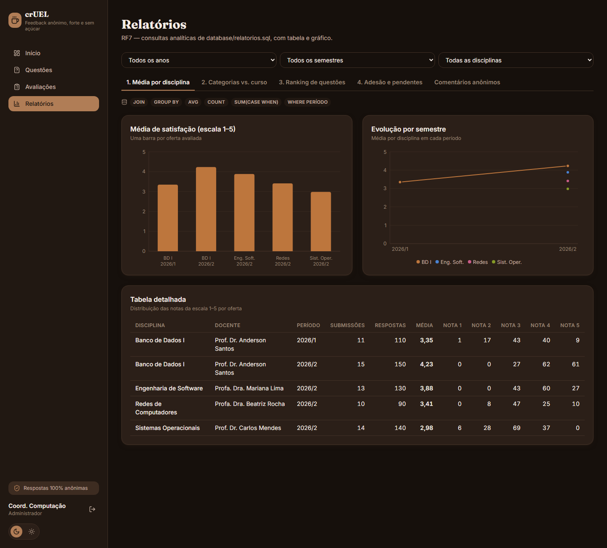

# crUEL — Sistema de Avaliação de Disciplinas e Docentes

Projeto final da disciplina de **Banco de Dados I** da Universidade Estadual de Londrina (UEL), desenvolvido por **Kauã Felipe Martins**, sob orientação do **Prof. Dr. Anderson Paulo Avila Santos**.

O sistema permite cadastrar questões, montar avaliações, indicar os usuários elegíveis, registrar respostas e apresentar resultados em relatórios com tabelas e gráficos.

## Natureza escolhida

**Avaliação de disciplinas ou docentes.**

A particularidade do sistema (RF6) é impedir que um aluno responda a mesma avaliação mais de uma vez por ano/semestre sem associar suas respostas à sua identidade. Essa regra é representada por duas partes separadas no banco:

- `participacao_avaliacao` registra o aluno e a avaliação respondida. Sua chave primária composta `(id_avaliacao, id_usuario)` impede uma segunda resposta.
- `submissao_anonima` e `resposta_questao` armazenam apenas a submissão, a avaliação e as respostas. Elas não possuem coluna ou chave estrangeira para `usuario`.

A gravação da participação, da submissão anônima e das respostas é realizada em uma única transação JDBC.

## Requisitos implementados

| Requisito | Implementação |
|---|---|
| RF1 | Cadastro de questões de múltipla escolha, escala de 1 a 5 e texto livre |
| RF2 | Cadastro de avaliações com título, descrição, data, horário de início/fim e situação |
| RF3 | Associação de questões já cadastradas a cada avaliação |
| RF4 | Associação de alunos e turmas às avaliações por meio das ofertas |
| RF5 | Resposta às avaliações pelos usuários elegíveis, com registro das respostas |
| RF6 | Resposta única por aluno/oferta e separação física entre identificação da participação e respostas |
| RF7 | Pelo menos três relatórios, cada um com tabela e gráfico e consultas SQL parametrizadas |

## Tecnologias

- PostgreSQL
- Java 21 e Spring Boot
- JDBC com `JdbcTemplate` e classes DAO
- React com Vite
- Recharts para os gráficos

O back-end não utiliza JPA, Hibernate, Spring Data JPA ou outra implementação de ORM. O acesso ao banco é feito exclusivamente por classes DAO.

## Estrutura do repositório

```text
.
├── backend/
│   └── src/main/java/br/uel/avaliacao/
│       ├── controller/
│       ├── service/
│       ├── dao/
│       ├── model/
│       ├── dto/
│       └── exception/
├── frontend/
│   └── src/
├── database/
│   ├── schema.sql
│   ├── carga.sql
│   └── relatorios.sql
└── docs/
    ├── DER.md
    ├── DER.png
    ├── DER.mmd
    ├── MER_e_esquema_relacional.md
    └── prints/
```

A arquitetura separa telas, controllers REST, serviços com regras de negócio e DAOs JDBC. Consultas SQL não são executadas diretamente pelas telas.

## Modelagem e integridade

O DER está em [docs/DER.md](docs/DER.md) e em [docs/DER.png](docs/DER.png). O esquema relacional e a justificativa da terceira forma normal estão em [docs/MER_e_esquema_relacional.md](docs/MER_e_esquema_relacional.md).

O [database/schema.sql](database/schema.sql) cria o banco do zero com:

- chave primária em todas as entidades;
- chaves estrangeiras;
- campos obrigatórios (`NOT NULL`);
- restrições `UNIQUE` e `CHECK`;
- integridade das respostas objetivas, de escala e de texto;
- chave composta para bloquear a repetição da participação.

O esquema está na 3FN. As disciplinas, docentes, questões, alternativas, ofertas e respostas ficam em entidades próprias, evitando dependências transitivas e grupos repetitivos.

## Pré-requisitos

- PostgreSQL 16 ou superior
- Java 21
- Maven, ou o Maven Wrapper incluso em `backend/mvnw`
- Node.js 20 ou superior
- npm

## Configuração

Na raiz do repositório, copie o arquivo de exemplo:

```bash
cp .env.example .env
```

Credenciais locais padrão:

```properties
DB_HOST=localhost
DB_PORT=5432
DB_NAME=avaliacao_docente_db
DB_USER=postgres
DB_PASSWORD=postgres
SERVER_PORT=8080
CORS_ALLOWED_ORIGINS=http://localhost:5173
```

Configure o usuário e a senha do PostgreSQL conforme a instalação local.

No diretório do front-end, copie o arquivo de configuração:

```bash
cd frontend
cp .env.example .env
```

O arquivo deve conter:

```properties
VITE_API_URL=http://localhost:8080/api
```

## Criar e carregar o banco

Crie um banco vazio no PostgreSQL:

```bash
psql -U postgres -c "CREATE DATABASE avaliacao_docente_db;"
```

Execute os scripts nesta ordem:

```bash
psql -U postgres -d avaliacao_docente_db -v ON_ERROR_STOP=1 -f database/schema.sql
psql -U postgres -d avaliacao_docente_db -v ON_ERROR_STOP=1 -f database/carga.sql
```

O script de carga contém dados de teste suficientes para validar os cadastros e os relatórios.

Para recriar completamente o banco:

```bash
psql -U postgres -d postgres -c "DROP DATABASE IF EXISTS avaliacao_docente_db;"
psql -U postgres -d postgres -c "CREATE DATABASE avaliacao_docente_db;"
psql -U postgres -d avaliacao_docente_db -v ON_ERROR_STOP=1 -f database/schema.sql
psql -U postgres -d avaliacao_docente_db -v ON_ERROR_STOP=1 -f database/carga.sql
```

## Executar o back-end

Em Linux ou macOS:

```bash
cd backend
./mvnw spring-boot:run
```

No Windows:

```powershell
cd backend
.\mvnw.cmd spring-boot:run
```

A API fica disponível em `http://localhost:8080/api`.

## Executar o front-end

Em outro terminal:

```bash
cd frontend
npm install
npm run dev
```

Acesse `http://localhost:5173`.

O sistema utiliza login simples para identificar o usuário que responde às avaliações. Os usuários de demonstração estão definidos em `database/carga.sql`.

## Relatórios

As consultas dos quatro relatórios estão em [database/relatorios.sql](database/relatorios.sql). Cada consulta possui comentários indicando o relatório e os recursos SQL utilizados.

### Relatório 1 — Média por disciplina e docente

Mostra a média das questões de escala e a distribuição das respostas por oferta.

Recursos principais: `JOIN`, `WHERE`, `GROUP BY`, `AVG`, `COUNT` e `SUM`.



### Relatório 2 — Desempenho por categoria

Compara a média de cada disciplina ou docente em Didática, Conteúdo e Infraestrutura com a média geral do curso no mesmo período.

Recursos principais: `JOIN`, `WHERE`, `GROUP BY`, `HAVING`, agregação e subconsultas.


### Relatório 3 — Ranking das questões

Lista as questões mais bem avaliadas e mais críticas com seu índice de aprovação.

Recursos principais: `JOIN`, `LEFT JOIN`, `WHERE`, `GROUP BY`, `COUNT`, `CASE`, `ORDER BY`, `RANK()` e `FETCH FIRST`.


### Relatório 4 — Adesão e pendências

Mostra quantos alunos matriculados responderam, quantos estão pendentes e a taxa de adesão de cada avaliação.

Recursos principais: `JOIN`, `LEFT JOIN`, anti-join com `WHERE`, `GROUP BY`, `COUNT`, `CASE` e `NULLIF`.


Juntas, as consultas utilizam junção interna, junção externa, agregação e agrupamento, subconsulta, ordenação/ranking e filtros com `WHERE`.

## Validação mínima

Antes da entrega, validar:

```bash
psql -U postgres -d avaliacao_docente_db -v ON_ERROR_STOP=1 -f database/schema.sql
psql -U postgres -d avaliacao_docente_db -v ON_ERROR_STOP=1 -f database/carga.sql
psql -U postgres -d avaliacao_docente_db -f database/relatorios.sql
cd backend && ./mvnw test
cd ../frontend && npm install && npm run build
```

Também conferir pela interface:

1. cadastro de questão;
2. criação e montagem de uma avaliação;
3. indicação dos usuários elegíveis;
4. resposta de um usuário elegível;
5. bloqueio de uma segunda resposta;
6. quatro telas de relatório com tabela e gráfico.
