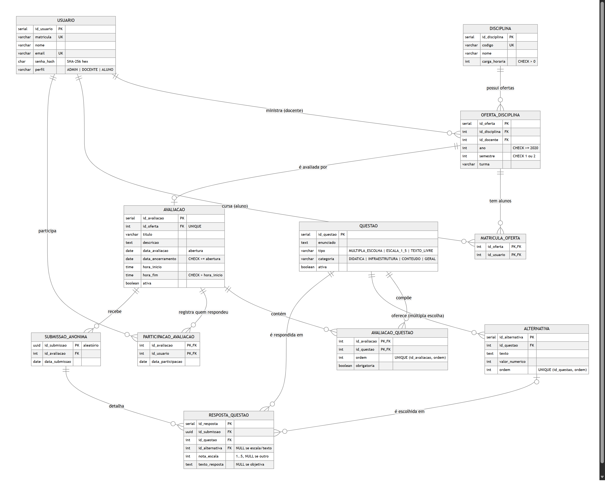
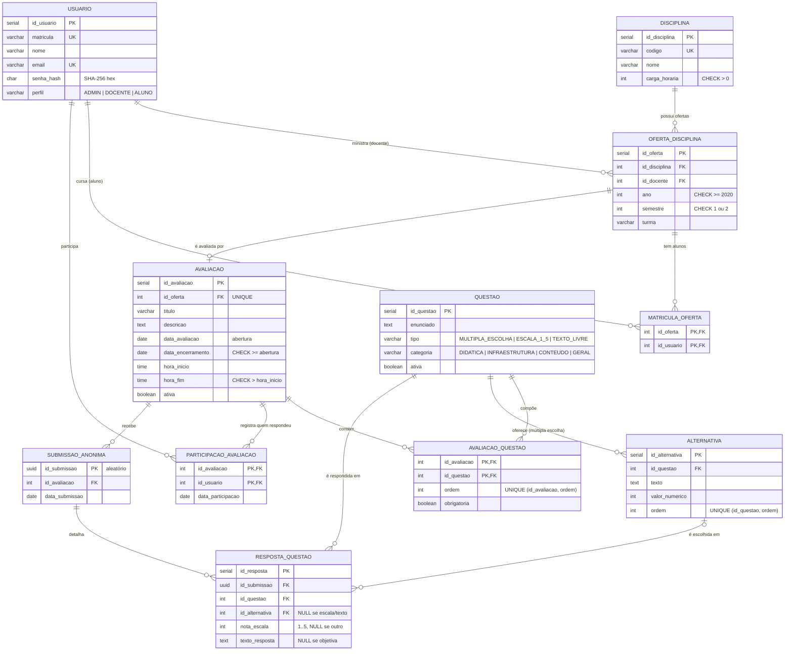

# DER — Diagrama Entidade-Relacionamento

Diagrama do banco de dados do **crUEL** (Avaliação Anônima de Disciplinas e Docentes), fiel ao
`database/schema.sql`. A imagem exportada está em [`DER.png`](DER.png).

## Diagrama (Mermaid)

O GitHub renderiza o bloco abaixo automaticamente.

## Leitura do diagrama

| Relacionamento | Cardinalidade | Observação |
|---|---|---|
| Disciplina — Oferta | 1 : N | Uma disciplina é oferecida em vários anos/semestres/turmas. |
| Usuário (docente) — Oferta | 1 : N | Cada oferta tem um único docente responsável. |
| Oferta — Usuário (aluno) | N : M | Resolvido por `MATRICULA_OFERTA` (alunos elegíveis — RF4). |
| Oferta — Avaliação | 1 : 0..1 | `UNIQUE (id_oferta)`: no máximo uma avaliação por disciplina/semestre/turma. |
| Avaliação — Questão | N : M | Resolvido por `AVALIACAO_QUESTAO`, com ordem e obrigatoriedade (RF3). |
| Questão — Alternativa | 1 : N | Apenas para questões de múltipla escolha (RF1). |
| Avaliação — Usuário | N : M | `PARTICIPACAO_AVALIACAO`: **quem** respondeu (PK composta impede 2ª resposta). |
| Avaliação — Submissão anônima | 1 : N | **O que** foi respondido, sem qualquer ligação com o usuário (RF6). |
| Submissão — Resposta | 1 : N | Uma linha por questão respondida. |

### Particularidade da natureza (RF6)

Observe no diagrama que **não existe caminho** entre `USUARIO` e `SUBMISSAO_ANONIMA`/`RESPOSTA_QUESTAO`:
as duas "ilhas" só se tocam pela `AVALIACAO`. Assim é possível saber *que* um aluno respondeu (e
bloquear uma segunda resposta), mas é impossível saber *o que* ele respondeu. Para evitar correlação
pela ordem de gravação, a submissão usa chave **UUID aleatória** e as duas tabelas guardam apenas a
**data** (sem hora).

## Como regenerar o `DER.png`

1. Abra o [Mermaid Live Editor](https://mermaid.live), cole o bloco `erDiagram` acima e use **Actions → PNG**; ou
2. Com Node.js instalado (o código-fonte do diagrama também está em [`DER.mmd`](DER.mmd)):
   `npx -p @mermaid-js/mermaid-cli mmdc -i docs/DER.mmd -o docs/DER.png -b white -w 2400`
